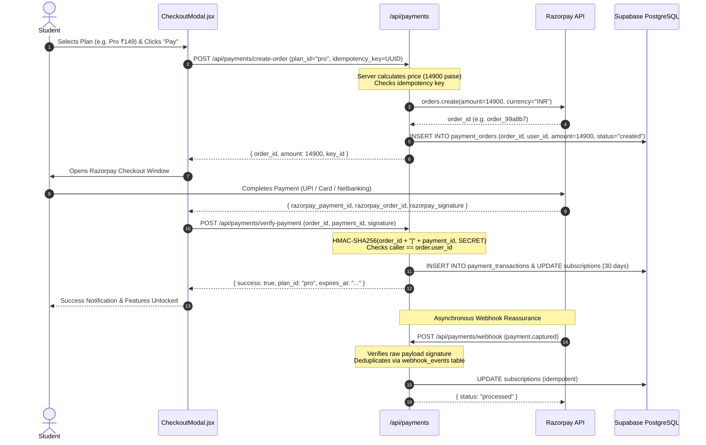

# CareerOS — System Architecture & Security Specification

**Version:** 2.0.0 (Hardened Production Architecture)  
**Last Updated:** 2026-10-31  
**Target Branch:** `voice`

---

## 1. System Topology & High-Level Flow

CareerOS employs a hybrid architecture combining a high-performance Single Page Application (SPA), serverless Supabase Backend-as-a-Service (BaaS), and a dedicated Python FastAPI AI microservice engine.

```mermaid
flowchart TD
    User["Student / TPO / Admin Browser"] -->|HTTPS / WSS| Frontend["React 19 Frontend SPA (Vercel / Netlify)"]
    Frontend -->|Direct PostgREST / RLS| Supabase["Supabase Cloud (PostgreSQL 15 + GoTrue Auth)"]
    Frontend -->|REST APIs with Bearer JWT| FastAPI["FastAPI AI & Security Engine (Render)"]
    
    subgraph FastAPI_Internal ["FastAPI AI Microservice Internal Subsystems"]
        RateLimiter["IP / Token Rate Limiter (TRUST_PROXY_HEADERS Guarded)"]
        JWTVirtualEngine["Dual JWT Verification (ES256 JWKS / HS256 Secret)"]
        QuotaEnforcer["Monthly Server-Authoritative Quota Engine (UTC Buckets)"]
        BOLAGuard["Multi-Tenant Campus Isolation Guard (resolve_authorized_institution)"]
        PromptSanitizer["Prompt Sanitizer (XML Escape & Length Clamping)"]
        PaymentEngine["Razorpay Payment Service (HMAC-SHA256 & Idempotency)"]
        LLMEngine["Universal LLM Engine (Groq LPU / OpenAI / Gemini)"]
    end

    FastAPI --> RateLimiter
    RateLimiter --> JWTVirtualEngine
    JWTVirtualEngine --> QuotaEnforcer
    QuotaEnforcer --> BOLAGuard
    BOLAGuard --> PromptSanitizer
    PromptSanitizer --> LLMEngine
    FastAPI --> PaymentEngine

    FastAPI -->|Service Role (Admin RPC)| Supabase
    FastAPI -->|REST API (Paise Orders)| RazorpayAPI["Razorpay Payment Gateway API"]
    RazorpayAPI -->|Signed Webhooks| FastAPI
    LLMEngine -->|HTTPS Zero-Storage| ExternalLLM["Groq LPU (llama-3.3-70b-versatile)"]
```

---

## 2. Authentication & Cryptographic Verification Architecture

### Dual-Mode JWT Verification (`backend/routers/admin.py`)
Supabase can issue tokens signed symmetrically (legacy HS256) or asymmetrically (modern ES256 P-256 ECC). CareerOS dynamically supports both with zero security bypass:

1. **Header Inspection**:
   - Reads token header: `alg` and `kid`.
   - Rejects `alg: none`, `RS256`, or unknown algorithms.

2. **Mode A: Asymmetric ES256 Verification (Supabase JWKS)**:
   - Fetches authoritative public keys from `https://<supabase-url>/auth/v1/.well-known/jwks.json`.
   - Caches JWKS with a 1-hour TTL.
   - Verifies cryptographic signature using ECDSA with P-256 and SHA-256.

3. **Mode B: Symmetric HS256 Verification (Supabase Secret)**:
   - Reads `SUPABASE_JWT_SECRET`.
   - If unset, **fails closed** (returns `None` / raises HTTP 401).
   - Verifies signature using constant-time HMAC-SHA256 (`hmac.compare_digest`).

4. **Mandatory Claims Enforcement**:
   - `exp`: Expiration timestamp (`time.time() < exp`).
   - `nbf`: Not-before timestamp (`time.time() >= nbf`).
   - `aud`: Audience must be `"authenticated"` or `"anon"`.
   - `sub`: Subject identifier must be non-empty string.
   - `iss`: Issuer must match `f"{SUPABASE_URL}/auth/v1"`.

---

## 3. Multi-Tenant Campus Isolation Architecture (BOLA Defenses)

CareerOS serves multiple colleges and universities from a shared infrastructure. Multi-tenancy is strictly isolated at both the database and API application layers:

### A. API Layer (`backend/routers/campus.py`)
- **Verified Context**: `verify_campus_access` resolves `{ email, role, institution_id, is_global_admin }` strictly from the cryptographically verified JWT.
- **Tenant Isolation**: `resolve_authorized_institution` compares requested `institution_id` with caller's verified `institution_id`. If they differ and caller is not a global admin, access is denied with **HTTP 403 Forbidden**.
- **Student Drilldown Protection**: A TPO requesting student drilldown (`/api/campus/students/{student_id}/drilldown`) queries only within their own institution boundary. Probing a student ID belonging to another college returns **HTTP 404 Not Found**, preventing student enumeration across colleges.
- **Deprecation of Query Token**: All endpoints strictly require `Authorization: Bearer <token>` in HTTP headers. Query parameter tokens (`?auth_token=...`) are completely rejected to prevent credential leakage in HTTP logs and proxy caches.

### B. Database Layer (`supabase/schema.sql`, `supabase/migrations/`)
- Base table `public.institutions` is restricted from public `SELECT`. Only authenticated platform admins and the institution's own TPO can query the table.
- Sanitized view `public.institutions_public_directory` exposes public metadata (`name`, `city`, `state`, `domain`) while redacting `invite_code`, `contact_name`, and `contact_email`.
- Batch code redemption uses atomic database RPC `verify_college_invite_code(p_code)` with rate limiting.

---

## 4. Commercial Subscription Quota & Rate Limiting Engine

### Plan Matrix & Authoritative Entitlements (`backend/services/quota_service.py`)
Subscription quotas are enforced server-side before initiating any LLM API call:

| Entitlement / Feature | Free Tier (₹0) | Pro Tier (₹149/mo) | Ultimate Tier (₹249/mo) |
|---|---|---|---|
| **ATS Resume Scans** | 2 / month | 25 / month | 75 / month |
| **Clean Resume Exports** | 1 (Watermarked) | 10 / month | 30 / month |
| **Voice Mock Interviews** | 1 / month (5 questions) | 10 / month | 30 / month |
| **SWE Simulation Tracks** | 1 starter task | 6 tasks | All 20+ pro tracks |
| **Career Copilot Chats** | 15 / month | 150 / month | 500 / month |
| **Bullet Enhancements** | 5 / month | 50 / month | 200 / month |
| **Job Matches** | 5 / month | 50 / month | 200 / month |
| **Monthly AI Token Cap** | 30 calls | 300 calls | 1,000 calls |

### Quota Enforcement Rules:
1. **Server-Side Authority**: The active plan is read strictly from server-managed `app_metadata.plan_id`. Client-controlled `user_metadata` is explicitly ignored.
2. **Monthly UTC Boundaries**: Quotas reset at 00:00 UTC on the 1st of each month (bucket key `f"{user_id}:{feature}:{YYYY-MM}"`).
3. **Thread Safety**: Quota increments and checks execute under `threading.Lock()` (`_tracker_lock`), preventing race conditions from concurrent requests.
4. **Founder Exemption**: Users with `role == 'founder'` or matching `FOUNDER_EMAIL` bypass quotas for platform maintenance.

---

## 5. Razorpay Payment Lifecycle & Webhook Architecture



### Security Defenses in Payment Flow:
1. **Server-Side Pricing**: The amount charged is looked up on the server (₹14900 paise for Pro, ₹24900 paise for Ultimate). Client input cannot alter prices.
2. **Idempotency Prevention**: A client-generated `idempotency_key` ensures rapid double-clicks return the existing order rather than charging twice.
3. **Cryptographic Signature Verification**: Every completed payment requires HMAC-SHA256 signature verification over `f"{order_id}|{payment_id}"`.
4. **Order Ownership Isolation**: The backend verifies that the caller's JWT `sub` matches the `user_id` stored on the order, preventing User B from claiming User A's order.
5. **Webhook Deduplication**: Webhook events are logged in `public.webhook_events`. If a delivery ID is received again, the server acknowledges it immediately with HTTP 200 without duplicate subscription extension.

