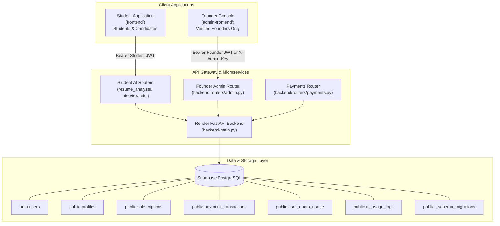

# CareerOS Founder Console — Architecture & System Design

## 1. Executive Summary
The CareerOS Founder Console is a completely decoupled, independent administrative frontend website designed specifically for platform founders and operators. It operates in total isolation from the student-facing application (`frontend/`), communicating with the shared FastAPI backend on Render and the authoritative Supabase PostgreSQL database.

---

## 2. Security Boundaries & Authorization Architecture

### A. Dual Cryptographic Authentication
Founder authentication enforces strict server-side verification via `verify_admin_access` on every protected admin route:
1. **Asymmetric / Symmetric Supabase JWT Path**:
   - Accepts verified Bearer JWTs issued by Supabase GoTrue Auth.
   - Verifies expiration (`exp`), audience (`aud`), subject (`sub`), not-before (`nbf`), and issuer (`iss`).
   - Verifies cryptographic signature via ES256 Supabase JWKS or HS256 secret.
   - Authorizes only when `email == FOUNDER_EMAIL` or server-controlled `app_metadata.role IN ('founder', 'admin')`.
   - **Client-side `user_metadata` is strictly ignored** to eliminate privilege escalation.
2. **Master Infrastructure API Key Path**:
   - Accepts constant-time secret comparison via header `X-Admin-Key` matching `ADMIN_API_KEY`.
   - Used for zero-latency direct operations and diagnostic automation.

### B. Session Isolation
The Founder Console uses browser `sessionStorage` rather than persistent `localStorage`. If an administrative tab is closed or a session expires (HTTP 401/403), the frontend immediately clears session memory and redirects to `/login`.

---

## 3. Database Dependencies & Ledger Isolation

| Table / View | Schema Layer | Founder Console Operational Role |
| :--- | :--- | :--- |
| `auth.users` | Supabase Internal | Registered student user identification, account creation dates, sign-in activity |
| `public.profiles` | Public | Candidate names, colleges, target roles, readiness scores |
| `public.subscriptions` | Public | Active plans (`free`, `pro`, `ultimate`), status, billing cycle, renewal dates |
| `public.payment_orders` | Public | Server-authoritative purchase intents and idempotency keys |
| `public.payment_transactions` | Public | Authoritative Razorpay captured payment ledger, amount in paise, error logs |
| `public.user_quota_usage` | Public | Monthly consumption totals for ATS scans, exports, interviews, simulations |
| `public.ai_usage_logs` | Public | Granular per-request prompt/completion tokens, latency, status, INR costs |
| `public.ai_usage_daily_summary` | Public (View) | Time-series rollups for daily token trends and provider expense aggregations |
| `public._schema_migrations` | Public | Advisory-locked database migration version and health verification |

---

## 4. Universal LLM Chokepoint & Token Attribution

Every AI generation executed in CareerOS—across Resume Analysis, Cover Letters, Interview Evaluations, and Simulations—funnels through `LLMEngine.generate()` in `backend/services/llm_engine.py`:
1. The authenticated caller's identity is propagated asynchronously via `services.request_context.get_current_user_id()`.
2. Provider-reported prompt and completion tokens (or fallback character ratios) are extracted directly from API responses.
3. Actual INR expenses are calculated using provider-specific rate cards (e.g. Llama 3.1 8B @ ₹4.25/₹6.80 per 1M, Gemini Flash @ ₹6.38/₹25.50 per 1M).
4. Persisted to `public.ai_usage_logs` in a non-blocking background try-catch to guarantee AI availability even during database network hiccups.

