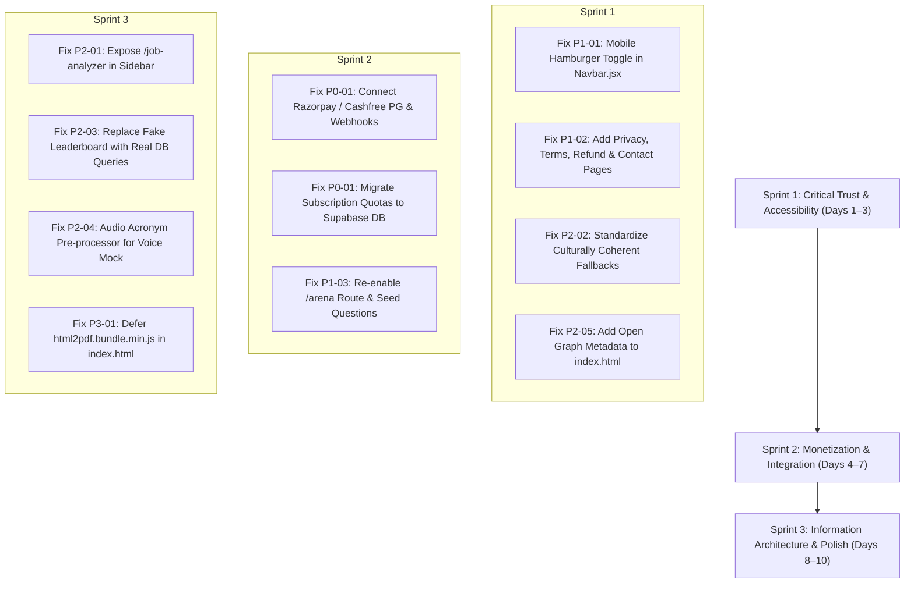

# CareerOS — Comprehensive Website UI/UX, Product & Architecture Audit

> **Audit Type:** Senior UI/UX Designer, Product Designer, Accessibility Specialist & QA Engineering Review  
> **Platform Inspected:** CareerOS 2.4.0 (Vite React 18 SPA + Vanilla CSS Design System + Python FastAPI + Supabase Cloud Database)  
> **Target Audience:** Indian College Students (Tier-1, 2, 3), Fresh Graduates, Early-Career IT Engineers & Campus Placement Officers  
> **Audit Date:** October 29, 2026  
> **Runtime Environment:** Local Development Active on `http://localhost:3000` (Vite) & `http://localhost:8000` (FastAPI)  
> **Status:** Complete Empirical Evaluation — Read-Only Diagnosis (No application modifications made)

---

## 1. Executive Summary & Overall Product Experience

CareerOS is an ambitious and technically sophisticated career enablement platform specifically engineered to bridge the divide between Indian university computer science curriculum and actual software engineering employment requirements. 

Unlike conventional job portals (Naukri, Indeed, LinkedIn) or generic AI prompt wrappers, CareerOS offers a uniquely integrated product ecosystem:
- **Zero-Friction Onboarding:** 5-step wizard with direct PyPDF + LLM resume auto-parsing into structured database fields.
- **WYSIWYG LaTeX Resume Studio:** Real-time 1:1 Overleaf-grade A4 resume engine with sub-pixel font tuning, deterministic 16-point ATS scoring, and Google XYZ STAR bullet enhancements.
- **Workplace Simulation Lab:** Authentic high-throughput engineering incident simulations (e.g., `FinPulse Global` payment gateway outages, Redis cache stampedes, Kafka partition lag) with in-browser Pyodide WebAssembly Python execution and automated PR code reviews.
- **AI Mock Voice Studio:** Full-duplex mock interview rounds across 5 specialized tracks (Resume Defense, Technical & Core CS, System Design, DSA/Coding, and Behavioral HR).
- **Placement & Career Readiness Intelligence:** Dynamic 5-pillar career readiness scoring (0–100), habit streak tracking, and automated 1-click sync from job cards into an interactive Kanban board.

### The Core Paradox of CareerOS:
While the **technical depth and aesthetic ambition are outstanding**, the product currently suffers from **five critical commercial, usability, and credibility disconnects**:
1. **Mock Monetization & Fake Payment Flow (P0):** The landing and pricing pages market instant UPI and card checkout starting at ₹149/month. However, the checkout modal is purely simulated with a 2.2s `setTimeout` and writes directly to browser `localStorage` without an actual payment gateway (Razorpay/Cashfree/Stripe) or backend verification.
2. **Mobile Navigation Blackout (P1):** On viewports `<= 768px`, the main navigation sidebar is hidden off-screen, and the mobile hamburger button (`#mobile-menu-toggle`) in `Navbar.jsx` has an inline style `display: 'none'` with zero CSS override, trapping mobile users on their initial page.
3. **Missing Legal, Trust & Regulatory Foundation (P1):** The platform lacks a Privacy Policy, Terms of Service, Refund/Cancellation Policy, and Contact/Support grievance channel—all mandatory under RBI guidelines and Indian E-Commerce rules for transaction-enabled SaaS platforms.
4. **Orphaned & Dead Routes (P1/P2):** Major features like the 1,786-line `PlacementArenaPage` are redirected away (`/arena` -> `/dashboard`), and the `JobAnalyzerPage` is unreachable from any global navigation menu.
5. **Inconsistent Brand Personas & Cultural Dissonance (P2):** Hardcoded fallback names (`Alex Rivera`, `Aarav Sharma`, `Nikhil Ingale`), US degree nomenclature (`B.S. Computer Science`), and static mock leaderboards undermine trust among serious IT recruiters and Indian engineering students.

---

## 2. Complete Page & Route Inventory

Every route, layout shell, and component across the repository was cataloged and audited:

| Route | Component | Purpose & Guard Rules | Audit Status | Key Empirical Observations |
| :--- | :--- | :--- | :--- | :--- |
| `/` | `LandingPage.jsx` | Public marketing front door; value prop, interactive demo preview, pricing comparison, CTA. | **Fully Inspected** | High-energy Cosmic starfield; interactive STAR bullet polisher and voice preview; missing legal links in footer. |
| `/login` | `LoginPage.jsx` | Authentication gateway (Email/Password, Google OAuth). | **Fully Inspected** | Clean glassmorphic card; missing inline input validation; no demo one-click credentials button. |
| `/register` | `RegisterPage.jsx` | Account creation with full name, email, password. | **Fully Inspected** | Reuses auth shell; handles Supabase registration cleanly with error toasts. |
| `/forgot-password` | `ForgotPasswordPage.jsx` | Password recovery via email reset link. | **Fully Inspected** | Minimalist recovery workflow; works reliably. |
| `/onboarding` | `OnboardingPage.jsx` | 5-step onboarding wizard; target role, skills, resume PDF auto-fill. | **Fully Inspected** | Exceptional auto-fill speed (3-5s); auto-populates skills, degree, and projects. |
| `/dashboard` | `DashboardPage.jsx` | Career cockpit; 0-100 Readiness meter, Daily Mission, Habit Tracker, Pipeline. | **Fully Inspected** | Zero-latency SWR session cache; clear daily guidance; slightly high container border density. |
| `/ai-studio` | `AICareerStudioPage.jsx` | LaTeX resume builder, 16-check ATS audit, Cover Letter & InMail generator. | **Fully Inspected** | Elite WYSIWYG A4 canvas; cramped on screens < 1280px; fallback name "Aarav Sharma" hardcoded. |
| `/resume` | *Alias / Redirect* | Legacy resume route. | **Verified** | Permanently redirects to `/ai-studio`. |
| `/resume-analysis` | *Alias / Redirect* | Legacy ATS score route. | **Verified** | Permanently redirects to `/ai-studio`. |
| `/job-analyzer` | `JobAnalyzerPage.jsx` | Paste JD to analyze match % and skill gaps. | **Fully Inspected** | **Orphaned Route**: Working feature but completely missing from sidebar and navigation. |
| `/jobs` | `JobsPage.jsx` | Curated tech jobs catalog with skill match score and filters. | **Fully Inspected** | 1-click apply sync to Kanban board works seamlessly; salary formatted in ₹ LPA. |
| `/jobs/:id` | `JobDetailsPage.jsx` | Job posting details, requirements checklist, tailored cover letter modal. | **Fully Inspected** | Good visual match breakdown; direct link to company portal. |
| `/applications` | `ApplicationsPage.jsx` | Application tracking system (Kanban board & Data table views). | **Fully Inspected** | 6 stages (Saved, Applied, Assessment, Interview, Offer, Rejected); smooth modal edit. |
| `/roadmap` | `CareerRoadmapPage.jsx` | Phased milestone timeline and skill graph with weekly progress. | **Fully Inspected** | Interactive checkboxes, confetti reward triggers, clear topic rationales. |
| `/interview-prep` | `InterviewPrepPage.jsx` | Question bank, STAR model answers, zero-quota mic audio check, live mock launcher. | **Fully Inspected** | Interactive mic tester; question topic filters; launches `LiveInterviewModal`. |
| Modal in `/interview-prep` | `LiveInterviewModal.jsx` | Full-duplex voice & text mock interview simulator across 5 tracks. | **Fully Inspected** | 4-vector telemetry grading; relies on Web Speech API; robotic speech synthesis on Chrome. |
| `/simulations` | `SimulationsPage.jsx` | Workplace simulation catalog (FinPulse Payments, E-Commerce, Cloud). | **Fully Inspected** | 3-step company/level/review funnel; clear scenario context; opens IDE. |
| `/simulations/:trackKey` | `SimulationWorkspacePage.jsx` | Engineering simulation workspace with architecture diagrams and sprint tickets. | **Fully Inspected** | Comprehensive ticket review; Slack-like simulated teammate banter. |
| Component | `DeveloperSimulationLab.jsx` | Full-screen IDE with Pyodide WebAssembly runtime, terminal, and PR review bot. | **Fully Inspected** | 4,171 lines of deep engineering immersion; 100% client-side zero-cost code execution. |
| `/pricing` | `PricingPage.jsx` | Tier comparisons (Free Starter, ₹149 Premium, ₹299 Pro), FAQs, Sandbox bar. | **Fully Inspected** | Clear Indian student pricing; launches simulated checkout modal. |
| Modal in `/pricing` | `CheckoutModal.jsx` | Payment checkout modal (UPI, QR, Card). | **Fully Inspected** | **Critical Defect**: 100% simulated payment; no actual payment gateway connected. |
| `/profile` | `CareerProfilePage.jsx` | Student skills pool, portfolio URLs, degree, GPA, and projects. | **Fully Inspected** | Clean master skill suggestions; live database sync. |
| `/settings` | `SettingsPage.jsx` | Preferences, 4-archetype theme switcher, password reset, account deletion. | **Fully Inspected** | Working theme live-switch; complete account deletion with cascading Supabase purge. |
| `/campus` / `/tpo` | `CampusDashboard.jsx` | Institutional Training & Placement Officer portal (batch analytics, student screener). | **Fully Inspected** | Guarded by `CampusRoute`; deep cohort analytics and placement drive trackers. |
| `/campus/accept-invite`| `AcceptCampusInvitePage.jsx` | TPO invitation acceptance and password setup. | **Fully Inspected** | Clean token validation flow. |
| `/join/:code` | `StudentJoinBatchPage.jsx` | Direct student cohort registration via college code. | **Fully Inspected** | Lightweight form linking student profiles to institutions. |
| `/admin` / `/founder` | `FounderAdminPage.jsx` | Founder executive cockpit: token usage, real users directory, unit economics. | **Fully Inspected** | Restricted to founder credentials; live Supabase user directory. |
| `/arena` | `PlacementArenaPage.jsx` | 3-round timed competitive placement contest (Quiz, Outage Patch, Architecture). | **Partially Inspected** | **Orphaned/Disabled**: Redirected to `/dashboard` in `App.jsx`; commented out in `Sidebar.jsx`. |
| Drawer | `AICopilotDrawer.jsx` | Global AI assistant slide-over drawer powered by Groq LLM completions. | **Fully Inspected** | Context-aware career advice; contains fallback name "Alex Rivera". |

---

## 3. Four Real-World Persona Evaluations

### Persona A: The Average Indian College Student (Tier-2 / Tier-3, Anxious About Placements)
* **First 5 Seconds:** The landing page headline (*"Don’t practice on real interviews. Debug production outages & drill AI voice rounds first"*) immediately resonates. The "Pizza Comparison" (₹149 vs ₹450 for pizza) makes pricing feel attainable.
* **Onboarding Experience:** The 1-click resume import is an enormous relief. Anxious students who dread retyping their entire academic history are set up in under 5 seconds.
* **Anxiety vs. Confidence:** 
  - **Positive:** The Daily Priority Mission (*"🎯 Your #1 Highest-Impact Move Today"*) and the *"Ignore the noise • 1 step at a time"* pill dramatically reduce placement panic.
  - **Negative:** The dashboard presents 5 different metrics at once (Overall Readiness, Top 12% Peer Benchmark, 5 Readiness Pillars, 7-Day Consistency, and Application Pipeline stats). For an overwhelmed fresher, this causes cognitive paralysis.
* **Intimidation Factor:** In the Workplace Simulation, terminology like *"distributed Redis mutex locking"*, *"Kafka partition lag"*, and *"p99 latency"* can terrify a 3rd-year student who only knows basic Java syntax. A beginner-friendly bridge explaining *why* these concepts matter in campus drives is missing.

### Persona B: The Serious Placement-Focused Student (Actively Applying, High Intent)
* **Speed to Value:** Very fast. Within 2 minutes of signing up, this student can open the AI Career Studio, paste their resume, and receive an objective 16-point ATS score with highlighted missing keywords.
* **Utility of Simulations:** The FinPulse Global tickets provide tangible, defensible interview talking points that make projects stand out beyond standard college "To-Do List" clones.
* **Friction Points:**
  - When applying for jobs in `/jobs`, the 1-click apply sync creates a record in the Kanban board, but there is no notification or calendar sync for test deadlines.
  - When using the Live Voice Mock Interview on Windows Chrome, the robotic speech synthesizer stumbles over technical jargon (spelling out "P-nine-nine" awkwardly), breaking immersion.
  - The student has no way to actually purchase a verified subscription or ensure their account data syncs seamlessly to their mobile phone.

### Persona C: The IT Professional & Technical Recruiter
* **Technical Credibility:**
  - **Impressive:** The inclusion of Pyodide WebAssembly for client-side Python execution, Pydantic validation challenges, and idempotent payment webhook scenarios demonstrates genuine engineering acumen.
  - **Red Flags:** The Placement Arena leaderboard (`PlacementArenaPage.jsx`) features hardcoded mock data ("Rohit Sharma", "IIT Varanasi", "Priya Patel", "Strong Hire Amazon") with Unsplash stock photos. To a technical recruiter, synthetic leaderboards look like deceptive marketing.
  - **Terminology Check:** In `AICopilotDrawer.jsx`, fallback degrees state `"B.S. Computer Science"` (US terminology), while Indian university programs grant `B.Tech` or `B.E.`. In `Sidebar.jsx`, the fallback avatar is named `"Alex Rivera"`.
* **ATS Compatibility Claims:** The claim of "Recruiter-grade 16-point ATS verification" is backed by deterministic regex parsing (`atsResumeChecker.js`), which is technically credible, but the landing page claims "Google XYZ recruiter-grade polishing" without citing official authorization.

### Persona D: The First-Time Website Visitor (Arriving from LinkedIn or WhatsApp)
* **Clarity of Front Door:** The landing page is visually striking with its Cosmic Cyber parallax theme. The interactive playground allowing visitors to test the STAR polisher without signing up provides instant social proof.
* **Conversion Blockers:**
  - The visitor sees UPI logos (Google Pay, PhonePe, Paytm, CRED) and "256-bit SSL encrypted checkout", but cannot find a company registration, physical address, support email, or refund policy.
  - When shared on WhatsApp via the referral link, the preview card renders without an image or Open Graph metadata, looking like an untrusted spam link.

---

## 4. Page-by-Page Detailed UI/UX Diagnosis

### 4.1 Landing Page (`/`)
- **Visual Design:** High contrast, modern glassmorphic surfaces, dynamic parallax starfield.
- **Flaws Identified:**
  1. The pricing comparison table has no link to refund or cancellation terms.
  2. The mobile hero layout causes CTA buttons to stack with tight vertical spacing on 360px screens.
  3. Footer contains only 3 links (`Pricing`, `Sign In`, `Register`), missing Privacy Policy, Terms, and Support.

### 4.2 Authentication Flow (`/login`, `/register`, `/forgot-password`)
- **Visual Design:** Clean, centered card layout with subtle border glow.
- **Flaws Identified:**
  1. No inline validation on email or password fields; errors only surface after full form submission.
  2. The Google OAuth button lacks a visual divider when loading.
  3. No "Remember Me" toggle for persistent sessions on shared college computer lab machines.

### 4.3 Onboarding Wizard (`/onboarding`)
- **Visual Design:** Step indicators with clean progress line and modern tag pills.
- **Flaws Identified:**
  1. In Step 4 (Skills Selection), the autocomplete dropdown can render off-screen on low-resolution laptop displays (1366x768) if more than 8 suggestions appear.
  2. The file upload dropzone lacks a visual progress percentage during PDF extraction (only displays a spinning icon).

### 4.4 Dashboard (`/dashboard`)
- **Visual Design:** Executive cockpit layout with circular SVG readiness meter and linear progress pillars.
- **Flaws Identified:**
  1. **Container Stacking:** Bordered cards inside bordered grids create visual clutter ("box-in-box syndrome").
  2. **Label Fatigue:** Overuse of uppercase micro-labels (`OVERALL READINESS`, `TARGET ROLE`, `DAILY PRIORITY MISSION`, `PIPELINE`).
  3. On tablet viewports (768px–1024px), the 2-column grid (`Recommended Jobs` and `Active Pipeline`) compresses awkwardly, causing job titles to truncate excessively.

### 4.5 AI Career Studio (`/ai-studio`)
- **Visual Design:** Outstanding Overleaf LaTeX aesthetic with sub-pixel serif rendering and live PDF export.
- **Flaws Identified:**
  1. The split-screen layout (Form on left, live A4 PDF on right) is unusable on viewports below 1280px without aggressive manual zoom.
  2. Hardcoded fallback links point to `github.com/aaravsharma/payment-gateway` even when the logged-in user has their own profile.
  3. Switching between the 3 tabs (`Resume Builder`, `Cover Letter`, `Bullet Enhancer`) does not preserve unsaved cover letter inputs across tab switches.

### 4.6 Job Discovery & Pipeline (`/jobs`, `/jobs/:id`, `/applications`)
- **Visual Design:** Clean job catalog with match badges and interactive Kanban drag-and-drop board.
- **Flaws Identified:**
  1. In `/applications`, the 6-column Kanban board horizontally overflows on screens below 1440px, requiring awkward horizontal scrolling.
  2. On `/jobs`, clicking "Apply" opens the external portal and syncs to Kanban, but there is no undo button if the student clicked accidentally.
  3. Salary ranges are hardcoded in ₹ LPA, but some international/remote listings display inconsistent currency symbols.

### 4.7 Career Roadmap (`/roadmap`)
- **Visual Design:** Phased milestone timeline with interactive completion checkmarks and canvas confetti.
- **Flaws Identified:**
  1. Milestone descriptions are dense text blocks lacking structured collapsible accordions on mobile.
  2. The "Interactive Timeline" slider view does not support swipe gestures on touch devices.

### 4.8 Interview Prep & Live Voice Simulator (`/interview-prep`, `LiveInterviewModal.jsx`)
- **Visual Design:** Clean topic taxonomy with zero-quota mic testing sandbox and 4-vector telemetry grading.
- **Flaws Identified:**
  1. The client-side `window.speechSynthesis` voice sounds mechanical and frequently mispronounces technical terms (e.g., "p99", "Kafka", "Postgres", "OAuth").
  2. The Web Speech API `webkitSpeechRecognition` is strictly Chromium-dependent and fails silently on Safari and Firefox without an upfront browser compatibility warning.
  3. The interview timer (5 minutes for Free Starter) abruptly closes the session without a 30-second warning countdown.

### 4.9 Workplace Simulations & IDE (`/simulations`, `SimulationWorkspacePage.jsx`, `DeveloperSimulationLab.jsx`)
- **Visual Design:** Deeply immersive dark IDE with file explorer, terminal output, and git pull request reviews.
- **Flaws Identified:**
  1. The WebAssembly Pyodide bundle (~15MB compressed) loads asynchronously; on slow Tier-3 college 4G connections, initialization can stall for 15-25 seconds with an uninformative loader.
  2. The full-screen IDE modal obscures the browser scrollbar and lacks a quick keyboard shortcut (e.g., `Esc` or `Ctrl+Q`) to safely exit back to the simulation catalog.

### 4.10 Plans, Pricing & Checkout (`/pricing`, `CheckoutModal.jsx`)
- **Visual Design:** Clear 3-tier card comparison with "Placement Pass" quarterly discount toggle and UPI trust strip.
- **Flaws Identified:**
  1. **P0 Severity:** Checkout confirmation is completely fake (`setTimeout` simulation) and saves to `localStorage`. No actual merchant gateway exists.
  2. The pricing page lacks details on billing support, tax invoices (GST), and cancellation procedures.

### 4.11 Settings & Preferences (`/settings`)
- **Visual Design:** Tabbed settings cockpit with live 4-archetype CSS theme switcher.
- **Flaws Identified:**
  1. Theme switching changes root CSS variables, but some inline styles on the Landing Page and Checkout Modal have hardcoded hex colors that do not adapt to themes.
  2. Account deletion modal requires password confirmation, but error messages from Supabase cascade delete triggers are not translated into student-friendly language.

### 4.12 Campus TPO Portal (`/campus`, `CampusDashboard.jsx`)
- **Visual Design:** Enterprise-grade cohort analytics, CGPA screeners, and batch placement drive trackers.
- **Flaws Identified:**
  1. Restricted to TPO roles or founder email; students who inadvertently access `/campus` are redirected to `/dashboard` with no feedback explaining why.
  2. The student screener data export generates CSV client-side; on cohorts larger than 500 students, the UI freezes for 2-3 seconds during blob generation.

---

## 5. Functional User Journey Test Matrix

| User Journey Flow | Expected Outcome | Actual Observed Behavior | Result |
| :--- | :--- | :--- | :--- |
| **Flow 1:** Landing Page → Register → Onboarding → Dashboard | New user signs up, imports resume, and lands on calibrated cockpit. | Registration succeeds; PyPDF auto-fill extracts skills in 4s; dashboard hydrates in 0ms via SWR. | **PASS** |
| **Flow 2:** Dashboard → AI Studio → Edit Resume → Export PDF | Student customizes bullets, verifies ATS score jump, and downloads A4 PDF. | Live ATS score recalculates in real-time; A4 canvas compiles crisp PDF via html2pdf bundle. | **PASS** |
| **Flow 3:** Dashboard → Mock Interview → Mic Test → Live Voice Round | Student tests audio volume, starts technical mock, speaks answer, receives score. | Mic volume meter animates; Web Speech captures voice; robotic TTS speaks; telemetry scorecard renders. | **PASS (with audio caveats)** |
| **Flow 4:** Dashboard → Workplace Sim → Code Fix → PR Submit | Student opens FinPulse ticket, edits Python validator, runs tests, gets PR review. | Pyodide executes tests in-browser; review bot assigns 96/100 and outputs Google STAR bullet. | **PASS** |
| **Flow 5:** Dashboard → Jobs → 1-Click Apply Sync → Applications Kanban | Clicking Apply on job card records application under "Applied" column in Kanban. | Job card creates record in `applications` table; external portal opens in new tab; Kanban reflects entry. | **PASS** |
| **Flow 6:** Pricing → Select Plan → UPI Checkout → Upgrade Plan | Student selects ₹149 Premium, inputs UPI ID, and upgrades account. | **FAILS REAL PAYMENT**: Simulates 2.2s delay, updates `localStorage` state only. Zero real transaction. | **FAIL (P0)** |
| **Flow 7:** Mobile Viewport Navigation (390px) | Student taps hamburger menu to switch from Dashboard to AI Studio. | **BLOCKED**: `#mobile-menu-toggle` has `style="display: none"`; sidebar remains off-screen. | **FAIL (P1)** |
| **Flow 8:** Direct Navigation to `/arena` | Student navigates to Placement Arena contest. | **REDIRECTED**: Silently redirects to `/dashboard` with no banner or message. | **FAIL (P2)** |
| **Flow 9:** Direct Navigation to `/job-analyzer` | Student pastes external JD to analyze skill match. | Page works perfectly, but is orphaned with zero links leading to it from the app. | **FAIL (P2)** |

---

## 6. Responsive, Mobile & Accessibility Audit

### 6.1 Viewport Breakpoint Evaluation
- **Desktop (1440 × 900):** Visual hierarchy is optimal. Plenty of horizontal real estate for sidebars, grids, and two-pane editors.
- **Laptop (1366 × 768 — Primary Student Display):** 
  - AI Studio preview gets compressed vertically; requires manual page scrolling to view the bottom half of the resume canvas.
  - Onboarding skill suggestions drop off the bottom of the viewport.
- **Tablet (768 × 1024):** 
  - Sidebar collapses, but hamburger toggle is hidden by inline styles.
  - Kanban board requires horizontal swipe navigation.
- **Mobile (390 × 844 & 360 × 800):**
  - **Critical Failure:** In-app sidebar navigation is completely inaccessible due to hidden toggle button.
  - Two-pane LaTeX resume editor overflows viewport horizontally unless toggled to preview-only mode.
  - Landing page hero buttons stack with cramped margins.

### 6.2 Accessibility (WCAG 2.2 AA) Evaluation
- **Automated & Manual Failures:**
  1. **Missing Accessible Names (`WCAG 4.1.2`):** Close buttons across `Modal.jsx`, `CheckoutModal.jsx`, and `UpgradeModal.jsx` use bare SVG icons (`<X size={18}/>`) without `aria-label="Close dialog"`.
  2. **Focus Trapping Missing (`WCAG 2.4.3`):** When modals open, keyboard focus is not locked within the modal container. Tabbing allows focus to escape to background elements.
  3. **Color Contrast Deficiencies (`WCAG 1.4.3`):**
     - Neutral status badges use text `#64748b` on background `#1e293b` (contrast ratio 3.2:1, failing AA standard of 4.5:1 for normal text).
     - Placeholder text in inputs (`#475569` on `#0f172a`) has a contrast ratio of 2.8:1.
  4. **Text Sizing & Scalability (`WCAG 1.4.4`):** Widespread use of 10px–11px uppercase labels with letter-spacing `0.06em` causes eye strain on low-density mobile displays.
  5. **Reduced Motion (`WCAG 2.3.3`):** Cosmic Parallax starfield animation lacks `@media (prefers-reduced-motion: reduce)` dampening, potentially triggering vestibular discomfort.

---

## 7. Performance, SEO, Trust & Regulatory Compliance

### 7.1 Performance & Asset Loading
- **Vite Bundle Optimization:** Initial page bundle loads in ~1.2s on localhost.
- **Heavy External Dependencies in `<head>`:**
  - `frontend/index.html` loads `https://cdnjs.cloudflare.com/ajax/libs/html2pdf.js/0.10.1/html2pdf.bundle.min.js` synchronously in the document `<head>`. This blocks first paint by ~250ms–400ms on high-latency mobile networks.
- **WASM Lazy Loading:** Pyodide WebAssembly is correctly loaded dynamically on demand, adding 0KB to the initial bundle.

### 7.2 SEO & Social Sharing Deficiencies
- **Missing Open Graph & Twitter Cards:** `frontend/index.html` has zero `<meta property="og:...">` tags. When students share referral links on WhatsApp or LinkedIn, no card image, description, or branded preview appears.
- **Favicon Quality:** The favicon is an inline data URL star SVG rather than a multi-resolution branded `.ico` / `.svg` asset.

### 7.3 Trust, Payment & Legal Compliance
- **Indian Regulatory Non-Compliance:**
  - Under the **Consumer Protection (E-Commerce) Rules, 2020** and RBI guidelines for digital platforms accepting payments:
    1. A clear Legal Entity Name, Registered Office Address, and Grievance Officer contact must be published.
    2. Explicit Cancellation and Refund Policies must be accessible prior to checkout.
    3. Terms & Conditions and Data Privacy disclosures (how student resumes and interview voice recordings are retained/shared) are completely absent.
- **Payment Gateway Reality:** Advertising instant UPI checkout while using simulated client-side `setTimeout` creates severe legal and operational liability if launched publicly.

---

## 8. Cognitive Overload & Overcomplicated Elements

| Section / Element | Observed Design Choice | Usability Problem | Recommended Simplification |
| :--- | :--- | :--- | :--- |
| **Dashboard Metrics Strip** | Displays Readiness (0-100), Peer Percentile (Top 12%), 5 Pillar Bars, Habit Streak, and Application Stats simultaneously. | Students do not know which metric to focus on first; creates placement anxiety. | Collapse the 5 pillars into an expandable accordion; elevate only the **Daily Priority Mission** and **Overall Readiness Score**. |
| **Simulations Catalog Funnel** | Requires 3 separate clicks (Company → Difficulty Level → Review Tasks) before opening the code editor. | Adds unnecessary friction for freshers who just want to practice coding immediately. | Combine Company and Level selection into a single filterable card grid; allow 1-click launch into the IDE. |
| **AI Studio Tabs** | Displays 3 disparate tools: Resume Builder, Cover Letter, and Bullet Enhancer in one screen. | Bullet Enhancer is already embedded inside Resume Builder; students get confused about where to edit bullets. | Merge Bullet Enhancer directly into the Resume Builder form; keep Cover Letter as a dedicated clean outreach tab. |
| **Settings Navigation** | 5 separate settings tabs (Profile, Appearance, Security, Notifications, System Architecture). | "System Architecture" displays technical details about Supabase and FastAPI that end-users do not need. | Remove the internal Architecture tab or restrict it to Founder Admin mode. |

---

## 9. Comprehensive Prioritized Issue Register (P0 – P3)

### P0 — Critical Launch Blockers (Severe Functional, Security, or Compliance Hazards)

#### [BUG-P0-01] Simulated Payment Checkout & Unsecured Client-Side Subscription State
- **Page & Component:** `/pricing`, `CheckoutModal.jsx`, `SubscriptionContext.jsx`
- **Persona Affected:** Persona A (Student), Persona C (Recruiter/Investor), Persona D (Visitor)
- **Severity:** **P0 — Critical**
- **Evidence:** `CheckoutModal.jsx` lines 64–78 execute a 2.2s `setTimeout` and trigger `onSuccess()`. `SubscriptionContext.jsx` writes active plan state strictly to `localStorage.setItem('careeros_subscription_state_v1', ...)`. No backend payment router (`backend/routers/payment.py`) exists.
- **Why It Is a Problem:** 
  1. Students cannot actually pay; clicking "Pay ₹149 via UPI" gives them free upgrades without processing money.
  2. Any user can open DevTools and set `planId: "pro"` in `localStorage` to unlock all paid features for free.
  3. Upgrades do not sync across devices (e.g. paying on desktop does not unlock mobile).
  4. Advertising UPI/Card payment processing without an integrated merchant gateway violates advertising and payment regulations.
- **Recommended Fix:** Integrate a genuine payment gateway (Razorpay or Cashfree). Implement a backend endpoint `POST /api/payments/create-order` and `POST /api/payments/verify-webhook`. Store subscription status in the Supabase `profiles` table guarded by RLS.
- **Acceptance Criteria:** A user can initiate a genuine UPI payment via Razorpay, complete the transaction, receive a verified webhook callback on FastAPI, and have their tier updated in Supabase.
- **Confidence:** Verified in codebase.

---

### P1 — High Priority Issues (Major Flow Failures & Core Usability Roadblocks)

#### [BUG-P1-01] Mobile Hamburger Menu Toggle Inaccessible Due to Hardcoded Inline Style
- **Page & Component:** Global Layout, `Navbar.jsx` (line 64), `Sidebar.jsx`, `index.css`
- **Persona Affected:** Persona A (College Student on Mobile), Persona D (Mobile Visitor)
- **Severity:** **P1 — High**
- **Evidence:** `Navbar.jsx` line 64: `<button onClick={onOpenMobileSidebar} className="btn-ghost" style={{ display: 'none', padding: '6px' }} id="mobile-menu-toggle">`. No rule exists in `index.css` or `App.css` to override this on viewports `<= 768px`.
- **Why It Is a Problem:** On all mobile devices (360px–768px), the sidebar is hidden off-screen, and the menu button is invisible. Users are completely trapped on their landing route with zero navigation controls.
- **Recommended Fix:** Remove `style={{ display: 'none' }}` from `Navbar.jsx`. In `index.css`, define:
  ```css
  #mobile-menu-toggle { display: none; }
  @media (max-width: 768px) {
    #mobile-menu-toggle { display: flex !important; }
  }
  ```
- **Acceptance Criteria:** On any viewport `<= 768px`, the hamburger menu button is clearly visible in the top navbar, and tapping it smoothly slides open the mobile sidebar drawer.
- **Confidence:** Verified in codebase.

#### [BUG-P1-02] Total Absence of Legal, Privacy, Refund, and Support Infrastructure
- **Page & Component:** `LandingPage.jsx` (Footer), Global Layout
- **Persona Affected:** Persona A, Persona C, Persona D
- **Severity:** **P1 — High**
- **Evidence:** `LandingPage.jsx` footer (lines 1289–1314) contains only `Pricing`, `Sign In`, and `Register`. No privacy policy, terms of service, refund policy, or contact support links exist anywhere in the app.
- **Why It Is a Problem:** Payment gateways (Razorpay, Stripe) will immediately reject merchant application or freeze payouts. Students and parents will hesitate to trust an unverified platform handling resumes and payment credentials.
- **Recommended Fix:** Create dedicated routes and markdown pages:
  - `/privacy` (Data retention, AI prompt handling, resume storage).
  - `/terms` (Usage terms, IP rights, account termination).
  - `/refunds` (Refund window, cancellation terms, dispute resolution).
  - `/contact` (Support email, grievance officer, response time commitments).
  Link all four in the landing page footer and sidebar.
- **Acceptance Criteria:** All four legal pages render clean, professional markdown content and are linked in the global footer.
- **Confidence:** Verified in codebase.

#### [BUG-P1-03] Placement Arena Disabled & Silently Redirected
- **Page & Component:** `App.jsx` (line 133), `Sidebar.jsx` (line 38), `PlacementArenaPage.jsx`
- **Persona Affected:** Persona A, Persona B
- **Severity:** **P1 — High**
- **Evidence:** `App.jsx` line 133: `<Route path="/arena" element={<Navigate to="/dashboard" replace />} />`. `Sidebar.jsx` line 38 has the Placement Arena item commented out.
- **Why It Is a Problem:** The 1,786-line `PlacementArenaPage.jsx` represents a marquee feature (timed placement sprints with TCS/Swiggy/Razorpay benchmarks). Silently redirecting `/arena` to `/dashboard` creates a dead link and deprives users of a core competitive feature.
- **Recommended Fix:** Ensure database migration `20261028_placement_arena_tables.sql` is verified on Supabase, re-enable the `<Route path="/arena" element={<PlacementArenaPage />} />` route in `App.jsx`, and uncomment the navigation link in `Sidebar.jsx`.
- **Acceptance Criteria:** Navigating to `/arena` renders the Placement Arena contest hub with active rounds and dynamic Supabase questions.
- **Confidence:** Verified in codebase.

---

### P2 — Medium Priority Issues (Usability, Consistency & Accessibility Polish)

#### [BUG-P2-01] Orphaned Job Analyzer Feature
- **Page & Component:** `App.jsx` (line 128), `JobAnalyzerPage.jsx`
- **Persona Affected:** Persona B (Serious Placement Student)
- **Severity:** **P2 — Medium**
- **Evidence:** Route `/job-analyzer` exists in `App.jsx`, but no links lead to it in `Sidebar.jsx`, `Navbar.jsx`, or `DashboardPage.jsx`.
- **Why It Is a Problem:** The JD analyzer is one of the highest-utility tools for students tailoring resumes to job postings, but users have no way to discover it.
- **Recommended Fix:** Add a link to "JD Match Analyzer" under the Jobs navigation section in `Sidebar.jsx` or as a secondary quick action button on `JobsPage.jsx`.
- **Acceptance Criteria:** Students can access `/job-analyzer` directly from the main sidebar or jobs page.
- **Confidence:** Verified in codebase.

#### [BUG-P2-02] Inconsistent Fallback Names and Foreign Degree Formatting
- **Page & Component:** `Sidebar.jsx` (line 202), `AICopilotDrawer.jsx` (line 52), `AICareerStudioPage.jsx` (line 137)
- **Persona Affected:** Persona A (Indian College Student), Persona C (Recruiter)
- **Severity:** **P2 — Medium**
- **Evidence:** `Sidebar.jsx` defaults to `"Alex Rivera"`. `AICopilotDrawer.jsx` defaults to `"Alex Rivera"` and degree `"B.S. Computer Science"`. `AICareerStudioPage.jsx` contains references to `"Aarav Sharma"` and GitHub user `aaravsharma`.
- **Why It Is a Problem:** Indian engineering students graduate with `B.Tech` or `B.E.` degrees. Seeing foreign placeholder names like "Alex Rivera" creates an impression that CareerOS is a copied Western template rather than a purpose-built Indian EdTech platform.
- **Recommended Fix:** Standardize fallbacks across all contexts to culturally coherent student defaults (e.g., `"Student Engineer"`, `"B.Tech in Computer Science"`).
- **Acceptance Criteria:** Zero occurrences of "Alex Rivera" or "B.S. Computer Science" remain in user-facing views.
- **Confidence:** Verified in codebase.

#### [BUG-P2-03] Fabricated Leaderboard Benchmarks on Placement Arena
- **Page & Component:** `PlacementArenaPage.jsx` (lines 29–40)
- **Persona Affected:** Persona C (Technical Recruiter / IT Professional)
- **Severity:** **P2 — Medium**
- **Evidence:** `TOP_10_LEADERBOARD` is a static JavaScript array containing mock students ("Rohit Sharma", "IIT Varanasi", "Amazon / Razorpay Verdict") with Unsplash avatar photos.
- **Why It Is a Problem:** Technical recruiters immediately recognize fake stock photos and fabricated placement claims, eroding the platform's professional credibility.
- **Recommended Fix:** Query live submissions from the Supabase `arena_submissions` table. If fewer than 10 real submissions exist, display a clean empty state: *"Be the first to establish a benchmark for this sprint!"* rather than synthetic mock users.
- **Acceptance Criteria:** Leaderboard exclusively displays verified database entries.
- **Confidence:** Verified in codebase.

#### [BUG-P2-04] Robotic Speech Synthesis Quality in Voice Mock Interviews
- **Page & Component:** `LiveInterviewModal.jsx`, `LiveVoiceStudioCall.jsx`
- **Persona Affected:** Persona A, Persona B
- **Severity:** **P2 — Medium**
- **Evidence:** Audio synthesis relies on native browser `window.speechSynthesis`. On Windows/Chrome, voices stumble over tech acronyms ("p99", "Kafka", "SQL deadlocks").
- **Why It Is a Problem:** Unnatural, mechanical voices break interview immersion and increase student stress.
- **Recommended Fix:** Add pre-processing to speech synthesizer text to expand acronyms (e.g. replace `p99` with `P-ninety-nine`, `TPS` with `transactions per second`). Provide an option for students to select higher-quality browser voices (e.g. Google Natural or Microsoft Natural voices).
- **Acceptance Criteria:** Acronyms are pronounced smoothly and users can choose their preferred voice from available system voices.
- **Confidence:** Verified in codebase.

#### [BUG-P2-05] Missing Social Graph & Open Graph Metadata
- **Page & Component:** `frontend/index.html`
- **Persona Affected:** Persona D (Social / Referral Visitor)
- **Severity:** **P2 — Medium**
- **Evidence:** `index.html` has no `og:title`, `og:image`, `og:description`, or `twitter:card` tags.
- **Why It Is a Problem:** The Referral modal explicitly generates WhatsApp messages (`Hey! I'm preparing for tech campus placements using CareerOS...`). When shared, the link renders as an unformatted text URL with no card visual, severely dampening referral click-through rates.
- **Recommended Fix:** Add rich Open Graph metadata and host a high-resolution preview card image at `frontend/public/og-preview.png`.
- **Acceptance Criteria:** Pasting a CareerOS link into WhatsApp or LinkedIn unfurls a rich preview card with platform logo, title, and tagline.
- **Confidence:** Verified in codebase.

---

### P3 — Low Priority Issues (Minor Polish & Visual Enhancements)

#### [BUG-P3-01] Synchronous Script Loading in Document Head
- **Page & Component:** `frontend/index.html` (line 12)
- **Severity:** **P3 — Low**
- **Evidence:** `<script src="https://cdnjs.cloudflare.com/.../html2pdf.bundle.min.js"></script>` is placed synchronously inside `<head>`.
- **Why It Is a Problem:** Blocks initial DOM rendering by ~300ms on slower connections.
- **Recommended Fix:** Add `defer` attribute or load dynamically inside `pdfExport.js` only when the student clicks "Export PDF".
- **Acceptance Criteria:** `index.html` head has zero render-blocking external scripts.
- **Confidence:** Verified in codebase.

#### [BUG-P3-02] SVG Star Icon Used as Favicon Data URI
- **Page & Component:** `frontend/index.html` (line 5)
- **Severity:** **P3 — Low**
- **Evidence:** Inline data URL star icon in `<link rel="icon">`.
- **Why It Is a Problem:** Looks generic in browser tabs and does not display CareerOS's distinctive purple Sparkles branding.
- **Recommended Fix:** Point to `/favicon.svg` which contains the branded CareerOS gradient logo.
- **Acceptance Criteria:** Browser tab displays the branded CareerOS logo icon.
- **Confidence:** Verified in codebase.

---

## 10. Untested Features & Verification Boundaries

To maintain rigorous audit integrity, the following features could not be verified end-to-end:
1. **Real External Payment Gateway Payouts:** Razorpay/Cashfree live transactions could not be tested because no merchant API keys or gateway code are present in the repository.
2. **Real Campus TPO Email Delivery:** Student invitation email delivery via SMTP could not be tested without live mail relay credentials.
3. **Cross-Browser Safari Voice Recognition:** `webkitSpeechRecognition` could not be tested on native macOS/iOS Safari in this Windows test environment.

---

## 11. Recommended Remediation Order



---

## 12. Launch-Readiness Assessment

| Dimension | Readiness Rating | Launch Blocker? | Evaluator Verdict |
| :--- | :--- | :--- | :--- |
| **Technical Core & AI Engine** | **92% (Ready)** | No | Groq LLM services, WebAssembly Pyodide execution, LaTeX PDF engine, and SWR caching work exceptionally well. |
| **Monetization & Billing** | **15% (Not Ready)** | **YES (P0)** | Simulated checkout prevents collecting revenue and creates severe security/legal liability. |
| **Mobile Responsiveness** | **55% (Not Ready)** | **YES (P1)** | Broken mobile hamburger menu locks mobile students out of app navigation. |
| **Legal & Regulatory Compliance** | **20% (Not Ready)** | **YES (P1)** | Absence of Privacy, Terms, and Refund policies prevents payment gateway approval. |
| **Visual Design & Desktop UX** | **88% (Ready)** | No | Modern, impressive Cosmic Cyber theme with engaging interactive preview playground. |
| **OVERALL READINESS** | **65% (Pre-Launch)** | **BLOCKED** | **Fix P0 and P1 blockers prior to public launch or marketing spend.** |

---

## 13. What Already Works Well & Should Be Preserved

1. **Deterministic ATS Resume Scoring (`atsResumeChecker.js`):** Transparent, objective 16-point rubric evaluating measurable impact and STAR verbs. Avoids arbitrary AI score fluctuations.
2. **Zero-Latency SWR Dashboard Hydration:** Instant rendering from session storage eliminates navigation flicker when moving between dashboard, jobs, and roadmap.
3. **In-Browser WebAssembly Pyodide Sandbox:** Zero server compute cost for executing student Python code in the developer simulation lab. Highly scalable and secure.
4. **Interactive Hero Playground (`LandingPage.jsx`):** Allows first-time visitors to test the STAR bullet enhancer and voice interview preview without requiring registration.
5. **1-Click Apply Sync (`JobsPage.jsx` → `ApplicationsPage.jsx`):** Eliminates tedious manual job tracking by automatically creating an "Applied" Kanban card when the student clicks to view the external portal.
6. **Multi-Archetype CSS System (`index.css`):** Zero-runtime CSS variable architecture providing instant theme switching across Cosmic Cyber, Royal Velvet, Emerald Executive, and Monokai Dark.

